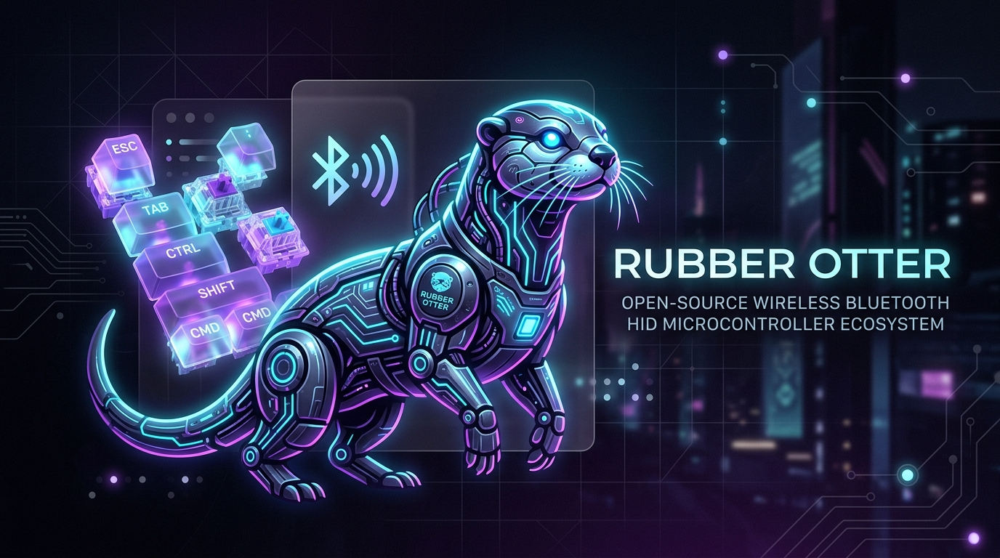

<p align="center">
  
</p>

# RubberOtter

[](https://github.com/AtaCanYmc/RubberOtter/actions/workflows/ci-firmware.yml)
[](https://github.com/AtaCanYmc/RubberOtter/actions/workflows/ci-python.yml)
[](https://github.com/AtaCanYmc/RubberOtter/actions/workflows/cd-github-pages.yml)
[](LICENSE)

RubberOtter is an open-source ATmega32U4 + HM-10/ESP32 wireless USB Human Interface Device (HID) hardware platform. This repository is focused exclusively on PlatformIO firmware, the ATmega32U4 Caterina 1200 bps Web Serial Flasher, and the `rubberotter` Python SDK, CLI, and MCP server.

## Control PWA and Mobile App (Moved to RubberDeck)

The web control PWA and Capacitor 8 mobile apps (Android/iOS) have moved to the unified standalone repository **[RubberDeck](https://github.com/AtaCanYmc/RubberDeck)**, which controls both RubberOtter and [RubberOrca](https://github.com/AtaCanYmc/RubberOrca) from a single interface.

- Live Control PWA: https://atacanymc.github.io/RubberDeck/
- Control PWA Repository: https://github.com/AtaCanYmc/RubberDeck
- RubberOtter Caterina Web Serial Flasher: https://atacanymc.github.io/RubberOtter/

## Repository Layout

| Directory | Scope | Primary Technologies | Documentation |
| :--- | :--- | :--- | :--- |
| [`firmware/`](firmware/) | Embedded C++ microcontroller firmware. | PlatformIO, Arduino, ATmega32U4, C++11 | [firmware/README.md](firmware/README.md) |
| [`site/`](site/) | Standalone Caterina 1200 bps Web Serial Flasher. | Static HTML, CSS, Web Serial API | https://atacanymc.github.io/RubberOtter/ |
| [`python/`](python/) | Client SDK, CLI, and MCP server (`rubberotter`). | Python 3.10+, Bleak, PySerial | [python/README.md](python/README.md) |
| [`docs/`](docs/) | Architecture, hardware wiring, protocol, and MCP specs. | Technical specifications | [docs/protocol-spec.md](docs/protocol-spec.md) |
| [`.github/`](.github/) | CI/CD workflows for firmware, flasher, and Python. | GitHub Actions, Release Please | [CONTRIBUTING.md](CONTRIBUTING.md) |

## Quick Start

### 1. Firmware (`firmware/`)

```bash
cd firmware
platformio run
platformio run --target upload
```

Or flash directly from a Chromium-based browser using the Caterina 1200 bps Web Serial Flasher at https://atacanymc.github.io/RubberOtter/.

### 2. Python SDK, CLI, and MCP Server (`python/`)

```bash
pip install rubberotter
```

Local development:

```bash
make install
make test
```

## Protocol Summary (RubberOtter v1)

- BLE 5.0 GATT Service: `0000ffe0-0000-1000-8000-00805f9b34fb`, Characteristic: `0000ffe1-0000-1000-8000-00805f9b34fb`
- Framed packet: `[STX: 0x02] [VER: 0x01] [SEQ: 1B] [LEN_HI: 1B] [LEN_LO: 1B] [PAYLOAD: <= 384 B] [XOR: 1B] [ETX: 0x03]`
- 6-byte ACK: `[0x02, 0x01, SEQ, OK, CODE, 0x03]` (`1`: invalid version/command, `2`: payload overflow, `3`: XOR mismatch)
- Single-byte shortcuts: `0x11`..`0x85` and `&&` / `;` command chaining

## License

Licensed under the Apache License 2.0. See [LICENSE](LICENSE).
