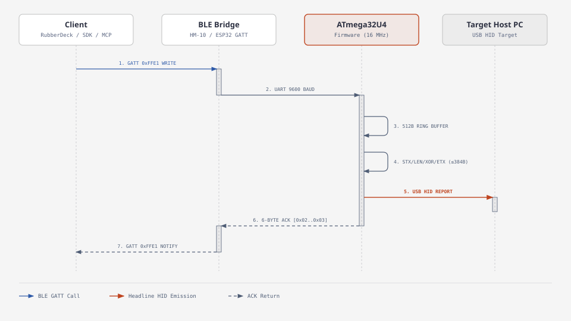

# RubberOtter System Architecture

[Back to Repository Root](../README.md)

This document describes the hardware boundaries, wire protocol flow, and component responsibilities across the three directories in this repository: `firmware/`, `site/`, and `python/`.

## End-to-End Data Flow

*[Interactive HTML](assets/architecture-sequence.html)*

## Repository Components

### 1. Firmware (`firmware/`)

- **Target MCU:** ATmega32U4 at 16 MHz (`leonardo`, `leonardo_hid`, `pro_micro`, `pro_micro_hid`, `pro_micro_hid_esp32` at 115200 baud, plus `native` host unit tests).
- **PacketParser:** State machine parsing RubberOtter v1 framed packets (`<= 384 B` payload) with XOR checksum verification and single-byte fallback shortcuts (`0x11`..`0x85`).
- **CommandExecutor:** Splits chained commands (`&&` and `;`) and dispatches HID keystrokes, mouse deltas, media controls, haptic pulses (Pin 2), and jiggler toggles.
- **MacroStore:** Persists macro slots `m0`..`m5` in ATmega32U4 EEPROM.

### 2. Static Caterina Flasher Site (`site/`)

- **Runtime:** Zero-build static HTML, CSS, and JavaScript deployed to GitHub Pages (`https://atacanymc.github.io/RubberOtter/`).
- **Function:** Triggers the 1200 bps Caterina bootloader reset over the browser Web Serial API, streams Intel HEX firmware directly via AVR109, fetches `.hex` assets from GitHub Releases, logs page ACK latency, and provides an offline RubberOtter v1 packet simulator.

### 3. Python SDK, CLI, and MCP Server (`python/`)

- **Package:** `rubberotter` (Python 3.10+, distributed on PyPI and Homebrew `AtaCanYmc/tap/rubberotter`).
- **Transports:** BLE GATT via `bleak` and USB CDC Serial via `pyserial`.
- **Interfaces:** Synchronous (`RubberOtter`) and asynchronous (`AsyncRubberOtter`) clients, `rubberotter` / `otter-cli` terminal tools, and a stdio MCP server (`rubberotter mcp`).

### 4. External Control Client (`RubberDeck`)

Interactive browser and mobile (Capacitor 8 Android/iOS) control interfaces live in [AtaCanYmc/RubberDeck](https://github.com/AtaCanYmc/RubberDeck) (`https://atacanymc.github.io/RubberDeck/`). RubberDeck connects to both RubberOtter (`384 B` profile) and [RubberOrca](https://github.com/AtaCanYmc/RubberOrca) (`1024 B` ESP32-S3 profile).
